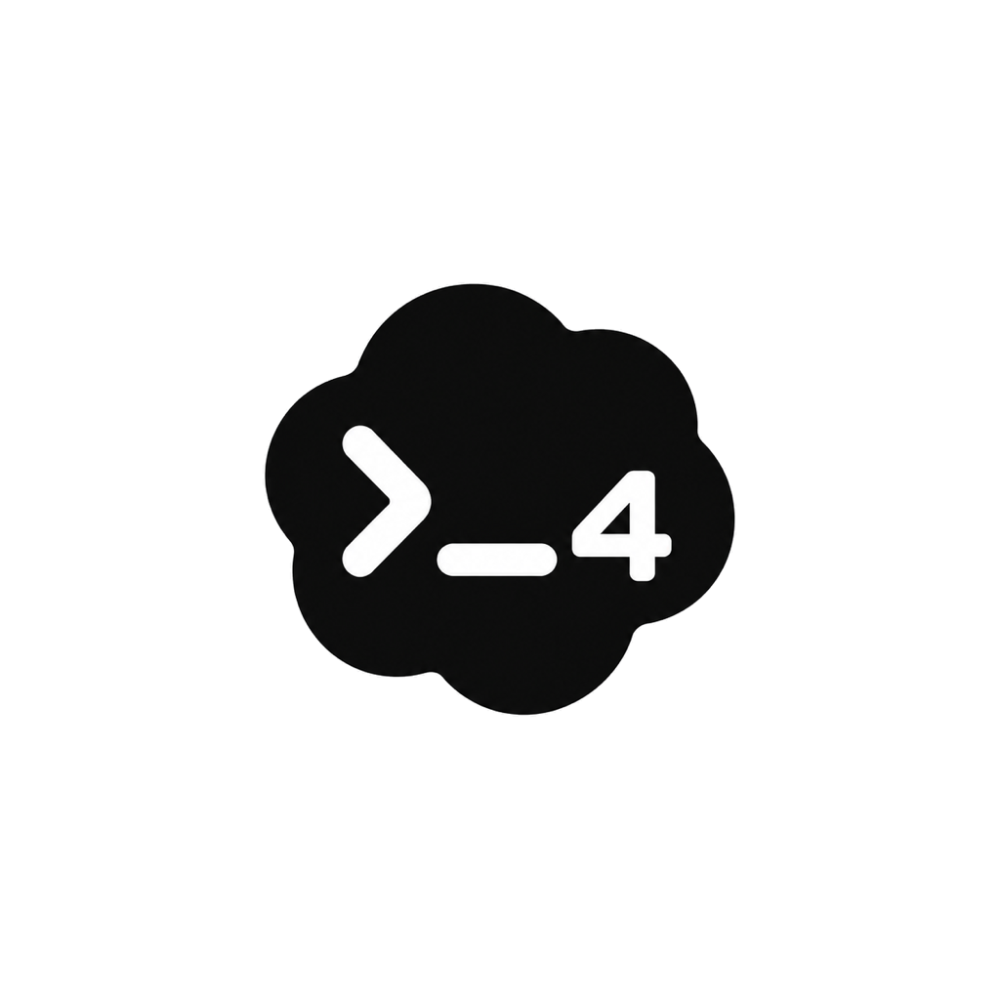
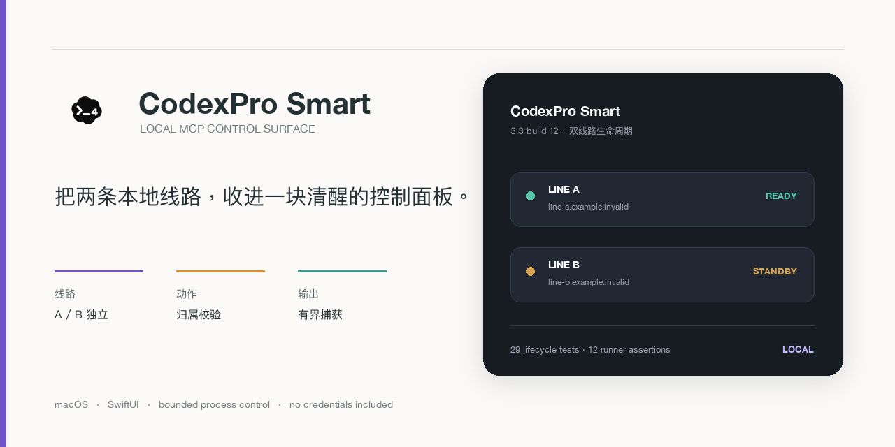

# CodexPro Smart

<p align="center">
  
</p>

<h2 align="center">把两条本地线路，收进一块清醒的控制面板。</h2>
<p align="center">一个面向 macOS 的双线路 MCP 生命周期控制器，关注状态诚实、进程归属和可回退操作。</p>

<p align="center">
  
</p>

<p align="center">
  <a href="#设计重点">设计重点</a> ·
  <a href="#构建">构建</a> ·
  <a href="#安全边界">安全边界</a>
</p>

<table align="center">
  <tr>
    <td><strong>版本</strong><br>3.3 / build 12</td>
    <td><strong>平台</strong><br>macOS 13+</td>
    <td><strong>技术</strong><br>SwiftUI · AppKit</td>
    <td><strong>状态</strong><br>Technical Preview</td>
  </tr>
</table>

> 这是本地控制界面的公开源码快照。真实线路、隧道、凭据和本机 LaunchAgent 配置不在本仓库中，连接器需要由使用者自行实现和审查。

## 设计重点

- A / B 两条线路分别显示状态、就绪检查、主机名、隧道数量和资源占用。
- 状态刷新按状态自适应：连接中更快，稳定在线时降低频率，避免重复启动检查。
- 控制命令使用有界输出捕获、超时和截断标记；命令失败或超时不会被界面写成成功。
- 关闭动作依赖外部控制脚本的归属校验，要求 PID、启动时间和完整命令匹配，不按端口或进程名批量结束。
- 复制连接地址时把凭据视为短时秘密，60 秒后只在剪贴板仍是本应用写入内容时清除。
- 默认不包含 token、Cloudflare 配置、运行日志、聊天导出、本机路径或个人数据。

## 公开快照结构

```text
Sources/
  CodexProSmart.swift       # SwiftUI/AppKit 控制面板和状态模型
  ControlRunner.swift       # 有界命令执行器
  CodexProSmart-icon.icns   # 应用图标
  build-smart.sh            # 本地 arm64 构建脚本
Examples/
  control-adapter.example.sh # 无凭据的控制脚本协议示例
```

公开快照没有携带原作者机器上的两条线路启动脚本。应用通过 `CODEXPRO_CONTROL_SCRIPT` 读取控制脚本路径，并通过 `CODEXPRO_A_HOST`、`CODEXPRO_B_HOST`、`CODEXPRO_A_TOKEN_FILE` 和 `CODEXPRO_B_TOKEN_FILE` 注入使用者自己的配置。

## 构建

需要 macOS 13 或更新版本、Swift 工具链和 Xcode Command Line Tools：

```sh
cd CodexProSmart-public/Sources
./build-smart.sh ../builds
codesign --verify --deep --strict "../builds/CodexPro Smart-3.3-12.app"
```

构建脚本只编译公开的 Swift 源码并进行本机 ad-hoc 签名，不安装应用、不注册登录启动项，也不会创建隧道。若只想检查源码，可以执行：

```sh
swiftc -parse-as-library -target arm64-apple-macos13.0 \
  Sources/ControlRunner.swift Sources/CodexProSmart.swift \
  -o /tmp/CodexProSmart-preview
```

## 验证记录

来自对应私有修复工作区的可复核记录：生命周期测试 `29/29` 通过，未触碰在线服务；原生 runner 断言 `12/12` 通过，覆盖大输出、管道继承、超时、启动失败、非法 UTF-8 和重复执行。公开仓库不把这些测试结果包装成远端线路或 MCP 鉴权已经验证。

## 安全边界

- 不要把真实 token、隧道凭据、登录态 URL 或本机路径提交到 Git。
- 外部控制脚本可能拥有启动服务、读取文件和结束进程的权限；请只连接自己审阅过的脚本。
- “线路就绪”只代表控制脚本返回就绪，不等于 MCP 鉴权、远端账号或 ChatGPT 工作区已验证。
- `CODEXPRO_CONTROL_SCRIPT` 指向的控制脚本应优先提供只读 `machine` / `diagnose`，再单独实现启动、重连和关闭动作。

详见 [SECURITY.md](SECURITY.md) 和 [Examples/control-adapter.example.sh](Examples/control-adapter.example.sh)。

## 来源与许可

项目由 Leo 发起并持续维护，开发过程中使用 AI 编程工具协助实现与测试。此仓库是从私有本地控制器中抽出的公开展示快照，不包含原机器的部署配置或凭据。源码按 [Apache-2.0](LICENSE) 发布；第三方来源和上游关系见 [PROVENANCE.md](PROVENANCE.md)。
